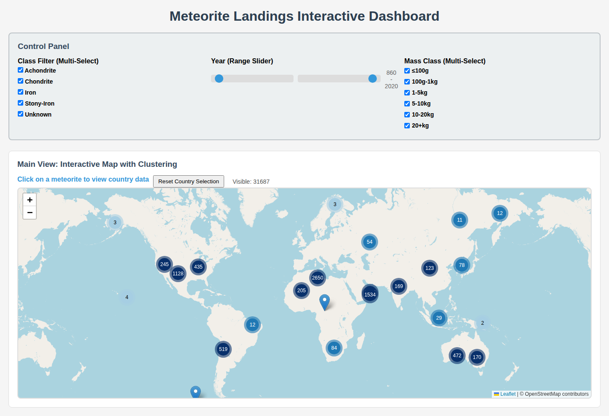

# Meteorite Landings Dashboard

Interactive map and charts of NASA's Meteorite Landings dataset. Plain JavaScript, runs entirely in the browser; Python is used only to clean the data.

**Live demo:** [jen-ne.github.io/meteorite-dashboard](https://Jen-NE.github.io/meteorite-dashboard/)



## Features

- Clustered Leaflet map; click a meteorite to select its country.
- Filters: general class, year range (860–2020), mass (six bins from ≤100 g to ≥20 kg).
- Six charts that follow the filters and the selected country: landings per year, cumulative discoveries, mass distribution by class (violin plot), top 15 classes, mass vs. year, and geographic distribution (top 20 countries, or a class sunburst for the selected country).
- Chart data is computed in a Web Worker, with a main-thread fallback.

## Data processing

[process_meteorite_data.py](process_meteorite_data.py) turns the raw NASA file (45,716 records) into the file the dashboard loads:

1. Removes records without coordinates (7,315), with missing or zero mass (138), or without a year (167). 38,096 remain.
2. Groups the detailed class (`recclass`) into five general classes (Chondrite, Achondrite, Iron, Stony-Iron, Unknown) using regular expressions.
3. Adds a country code with the offline [reverse-geocoder](https://github.com/thampiman/reverse-geocoder) library (nearest populated place).

When it loads the data, the dashboard also skips records at 0° latitude or longitude (placeholder coordinates) and years outside 860–2020, leaving 31,687 records.

Limitation: the nearest-place lookup is approximate in remote areas. For example, 6,402 finds south of 60° S are labelled ZA (South Africa).

## Run locally

From the repository root:

```bash
python3 serve.py        # static server, standard library only
```

Open http://127.0.0.1:8000/.

To rebuild the data file:

```bash
pip install -r requirements.txt
python3 process_meteorite_data.py
```

## Project structure

```
javascript-dashboard/       the app: HTML, JavaScript, Web Worker, processed CSV
process_meteorite_data.py   data cleaning and enrichment
Meteorite_Landings.csv      raw NASA data
serve.py                    local static file server
index.html                  redirect to the dashboard (GitHub Pages entry point)
```

## Built with

Leaflet with Leaflet.markercluster, Chart.js, Plotly.js and PapaParse in the browser; pandas, NumPy and reverse-geocoder for data processing.

## Data source

[Meteorite Landings](https://data.nasa.gov/dataset/meteorite-landings), NASA Open Data Portal (data from The Meteoritical Society). Map tiles © OpenStreetMap contributors.

## License

MIT, see [LICENSE](LICENSE).
